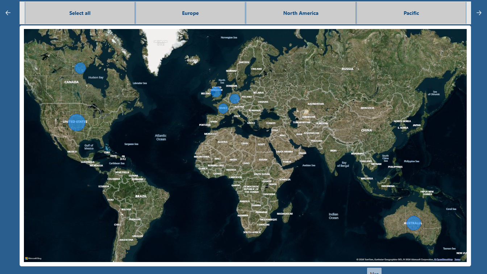
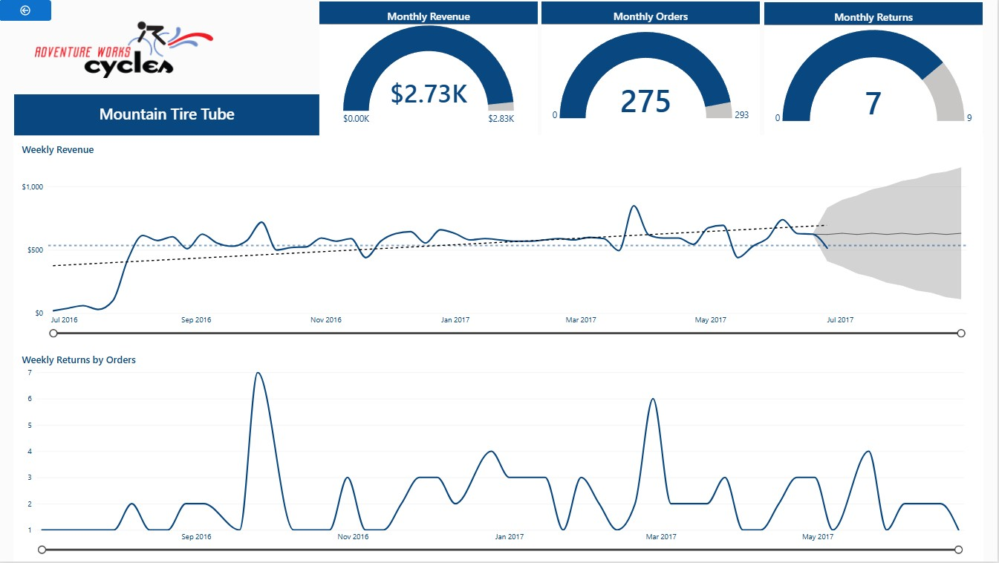
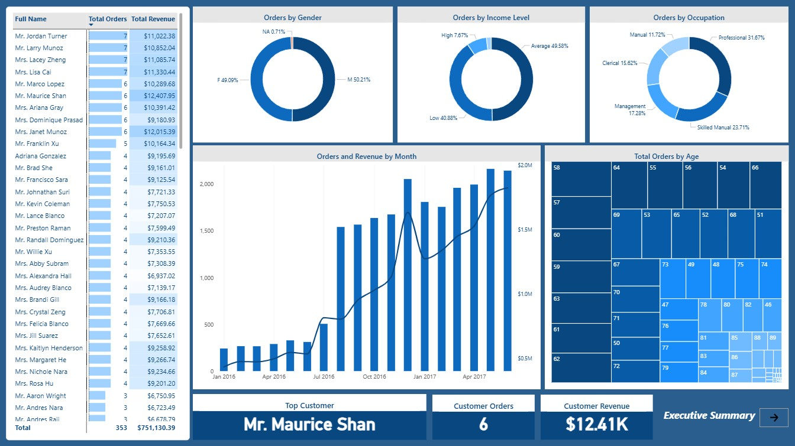

# Sales Analytics Dashboard | Power BI

My final project for the DigiSkills Data Analytics course is a multi-page Power BI report based on the Adventure Works Cycles business scenario. It explores sales performance, locations, product results, and customer details.

## Dashboard Preview

### 1. Executive Summary

This page gives an overview of revenue, profit, orders, return rate, monthly trends, and product performance.

### 2. Geographic Analysis

This page uses a map to explore where orders come from, with options to view order distribution by continent.

### 3. Product Detail

This page focuses on the Mountain Tire Tube product. It shows revenue, orders, returns, weekly revenue, and a revenue forecast.

### 4. Customer Analysis

This page explores customer orders and revenue, including customer groups, occupations, and monthly trends.

## Project Goals

- Present key sales measures in a clear way.
- Explore changes in revenue, orders, and returns over time.
- Review order patterns across locations.
- Explore product performance and customer groups.
- Present different parts of the business in separate report pages.

## Tool Used

- Microsoft Power BI Desktop

## Project Files

- `DigiSkills-Sales-Analytics.pbix` — the Power BI report file. Download it and open it with Power BI Desktop to explore the report.
- `screenshots/` — images of the four main dashboard pages shown above.

## About This Project

I created this project to improve my data analysis and dashboard design skills using Power BI. The four pages shown here are the main pages I selected for my portfolio. The PBIX file may contain other report pages as well.

## Feedback

I am continuing to build my data analytics skills. Feedback and suggestions on this project are welcome.
