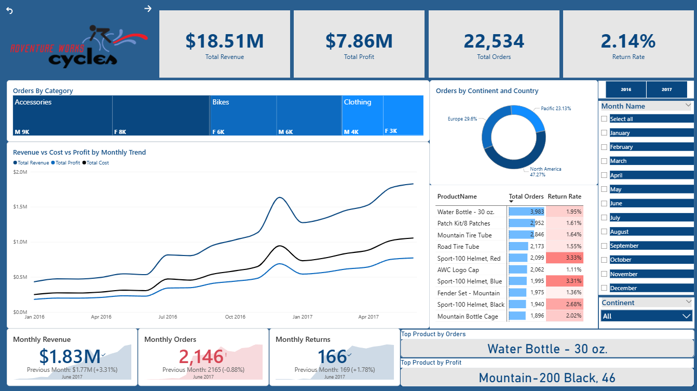

# Power BI Sales Analytics Dashboard

**An interactive multi-page business intelligence report built with Microsoft Power BI**

This project was developed during the DigiSkills Data Analytics & Business Intelligence course under the guidance and instruction of **Sir Jahangir Sachwani**. Using the Adventure Works Cycles business scenario, the dashboard transforms complex sales data into interactive views to help business stakeholders explore revenue trends, geographic performance, product margins, and customer behavior.

---

## Project at a Glance

- **Tool:** Microsoft Power BI Desktop
- **Business Scenario:** Adventure Works Cycles
- **Report Pages:** Executive Summary, Geographic Analysis, Product Detail, Customer Detail
- **Main Focus Areas:** Revenue, profit, order volume, product return rates, regional performance, and customer segmentation

---

## Dashboard Preview

### 1. Executive Summary
The Executive Summary brings key sales indicators and trends into one view. It includes live KPI cards, monthly performance, product information, and interactive slicers.

<p align="center"></p>

**What this page covers:**
- Revenue, profit, order volume, and return rate
- Monthly sales and profit trends
- Product and category performance
- Filtering by continent, month, and year

### 2. Geographic Analysis
The Map page helps users explore order distribution across geographic areas. It includes a continent slicer and location-based visuals.

<p align="center"></p>

**What this page covers:**
- Geographic distribution of orders
- Regional comparisons between countries and continents
- Location-based sales and order metrics

### 3. Product Detail
The Product Detail page is configured for item-level deep dives with dynamic drillthrough capabilities (demonstrated using the *Mountain Tire Tube*).

<p align="center"></p>

**What this page covers:**
- Product revenue and order performance
- Return volume tracking
- Weekly revenue trendlines
- Native Power BI forecasting visuals *(Forecasts are estimates based on historical data)*

### 4. Customer Detail
The Customer Detail page is configured as an interactive report page tooltip to provide immediate customer context without cluttering primary reporting canvases.

<p align="center"></p>

**What this page covers:**
- Customer-level revenue and order counts
- Top customer rankings and comparisons
- Customer breakdowns by available demographic attributes
- Monthly order and revenue patterns

---

## Key Metrics Summary

| Metric | Displayed Value |
|---|---:|
| **Total Revenue** | $18.51M |
| **Total Profit** | $7.86M |
| **Total Orders** | 22,534 |
| **Return Rate** | 2.14% |

*Note: Headline values represent default filter context and will adjust based on report slicer selections.*

---

## Data Architecture & Modeling

To ensure optimal performance and accurate filter context propagation, the report follows a clean **Star Schema** dimensional model:

| Table Name | Entity Type | Purpose |
|---|---|---|
| `Sales_Data` | Fact Table | Primary sales transactions, quantities, and prices |
| `Returns_Data` | Fact Table | Product return records and quantities |
| `Calendar_Lookup` | Dimension | Centralized date dimension enabling time-intelligence functions |
| `Customers_Lookup` | Dimension | Customer demographics, locations, and names |
| `Products_Lookup` | Dimension | Product names, SKU details, costs, and list prices |
| `Product_Subcategories_Lookup` | Dimension | Intermediate product categorization |
| `Product_Categories_Lookup` | Dimension | High-level product categories |
| `Territories_Lookup` | Dimension | Geographic regions, countries, and continents |

---

## Core DAX Calculations

Below are the primary DAX measures written for this dashboard:

```dax
// Total Revenue
Total Revenue = 
SUMX(
    'Sales_Data', 
    'Sales_Data'[OrderQuantity] * RELATED('Products_Lookup'[ProductPrice])
)

// Total Profit
Total Profit = 
[Total Revenue] - SUMX(
    'Sales_Data', 
    'Sales_Data'[OrderQuantity] * RELATED('Products_Lookup'[ProductCost])
)

// Total Orders
Total Orders = DISTINCTCOUNT('Sales_Data'[OrderNumber])

// Return Rate
Return Rate = DIVIDE([Total Returns], [Total Orders], 0)
```

## Business Questions

The report is designed to help explore questions such as:

1. How do revenue and profit change over time?
2. How do order volumes differ across geographic areas?
3. Which products contribute most to revenue and profit?
4. How do order and return measures vary by product?
5. Which customers generate the most revenue or orders?
6. What patterns appear in monthly sales and customer activity?

## Business Insights to Explore

The dashboard supports investigation of sales performance across products, geographic regions, and customer groups. The following are the main areas to explore:

- Products and categories with the highest revenue and profit.
- Geographic regions with the highest order volume.
- Changes in revenue and profit over time.
- Customers with the highest revenue or order counts.
- Differences in product return activity.

These are analysis areas, not confirmed findings. Any final conclusion should include actual values and relevant comparisons from the report.


## Tools and Skills

**Tool:** Microsoft Power BI Desktop

This project demonstrates report-building and business-visualization work in areas such as:

- KPI presentation
- Time-based trend analysis
- Geographic analysis
- Product performance analysis
- Customer analysis
- Interactive slicers, drillthrough, and tooltip configuration
- Report layout and visual consistency

## Technical Approach

The project follows a business-focused reporting workflow:

1. **Define the questions** — identify the sales and customer areas to explore.
2. **Review the data and measures** — understand the fields and calculations used in the report.
3. **Build the report pages** — organize the analysis into executive, geographic, product, and customer views.
4. **Add interactions** — use slicers, drillthrough, and tooltip behavior where configured.
5. **Review the results** — check values, filter behavior, labels, and visual clarity before drawing conclusions.

This is a high-level summary of the reporting workflow. Specific Power Query transformations, data-cleaning steps, relationships, and DAX formulas should only be listed when confirmed in the PBIX file.

## Project Files

| File or folder | Purpose |
|---|---|
| `DigiSkills-Sales-Analytics.pbix` | Main Power BI report |
| `screenshots/` | Dashboard preview images |
| `README.md` | Project documentation |

## How to View the Report

1. Download or clone this repository.
2. Open `DigiSkills-Sales-Analytics.pbix` in Microsoft Power BI Desktop.
3. Explore the report pages.
4. Try the available slicers and drillthrough interactions.
5. Review the measures and filter context before interpreting the results.

Power BI Desktop is required to open and interact with the PBIX file.

## Scope and Limitations

This is a learning and portfolio project, not a live business reporting system. The analysis reflects the dataset, measures, filters, and report design included in the PBIX file.

Forecasts are estimates. Business conclusions should be based on the underlying data and verified measure definitions. The KPI values shown above come from the portfolio screenshot and may change with report filters.

## About This Project

I created this project to develop my data analysis and business intelligence skills through practical dashboard work. It gave me an opportunity to organize sales-related information into several views and practise communicating data through visual reports.

I am continuing to improve my skills in Power BI, analytical thinking, and presenting findings in a clear and practical way. Feedback and suggestions are welcome.
